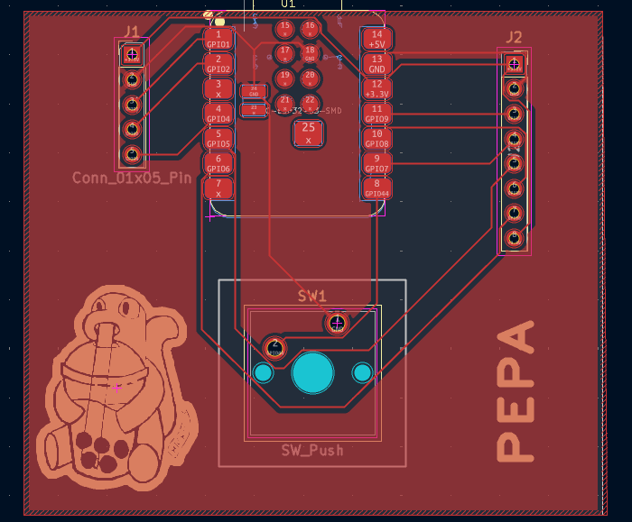
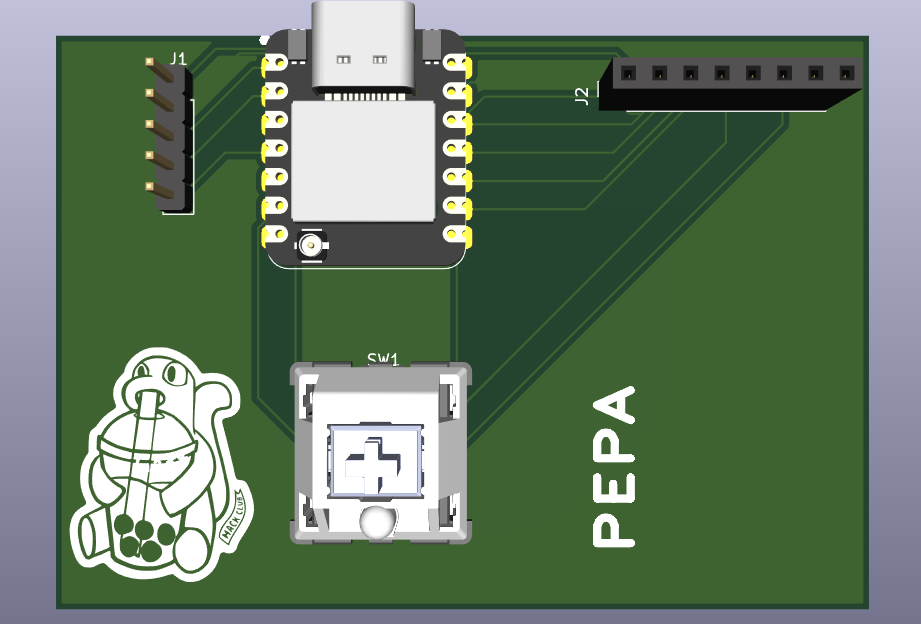

# Weather_device

A smart weather hardware inspired that meshtimes, that displays current weather conditions, time, and gives outfit recommendations. It connects to Wi-Fi, gets weather information from an online weather service, and displays it on a color TFT screen. It also has a pixel-art teddy bear, weather-themed music, and a button for controlling the audio.

**Components**
1. Seeed Studio XIAO ESP32-S3 - Connects to WiFi and gets HTTP response from Open Meteo
2. NS4168 I2S Audio Amplifier & 3W Speaker Kit - Plays sound based on weather.
3. 2.0inch SPI LCD TFT Display - Displays weather and outfit recommendations.

*Bill Of Materials (BOM)* 
| Part | Description | Qty | Unit Price | Total | Vendor |
|------|-------------|----:|-----------:|------:|-------------|
| XIAO ESP32-S3 (7.05) | MicroController | 1 | $7.49 | $7.49 | https://www.seeedstudio.com/XIAO-ESP32S3-p-5627.html |
| 2.0inch SPI LCD TFT Display | For display | 1 | $8.99 | $8.99 | https://www.amazon.com/dp/B0H8RNZY9M|
| 2.5mm 8 pin female header socket | Connects screen to PCB | 1 | $5.99 | $5.99 | https://www.amazon.com/dp/B0F3CXRDF3 |
| NS4168 I2S Audio Amplifier & 3W Speaker Kit | Plays sound | 1 | $9.99 | $9.99 | https://www.amazon.com/dp/B0GV33LRR5 |
| Male Header Pin 2.54 mm | Connects amplifier to PCB | 1 | $6.98 | $6.98 | https://www.amazon.com/dp/B0FLJVHSRN |
| PCB | Host all components | 1 | $10.00 | $10.00 | https://jlcpcb.com/quote |

   
